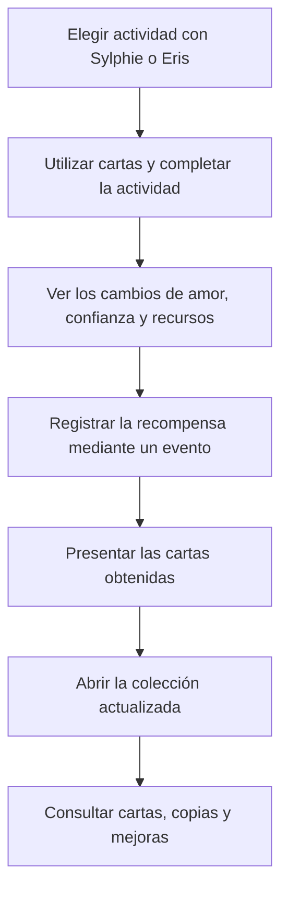

# Mushoku Tensei: Las Cartas del Destino

## Progression Cycles

### 1. Presentación de la entrega

Quería que las decisiones de Rudy durante el día tuvieran consecuencias que pudiera ver después en su colección. En la primera fase, Rudy visita a sus esposas, usa cartas para conversar y cambia sus relaciones y recursos. En la segunda, puede ver las cartas que obtuvo al completar la actividad y consultarlas más tarde. Preparé un recorrido corto con Sylphie y Eris que usa las mismas actividades, reglas y pantallas de la campaña. [Guía de la entrega](docs/ENTREGA_PROGRESSION_CYCLE.md).

### 2. Cómo ejecutar la demostración

El juego utiliza **LÖVE 11.5** con **LuaJIT**. [Descargar LÖVE 11.5](https://github.com/love2d/love/releases/tag/11.5).

Clona la rama de la entrega en PowerShell. [Rama entrega/progression-cycle en GitHub](https://github.com/Gegdgt/DateSim/tree/entrega/progression-cycle).

```powershell
git clone --branch entrega/progression-cycle --single-branch https://github.com/Gegdgt/DateSim.git
cd DateSim
```

Desde la carpeta `DateSim`, ejecuta el juego con este argumento.

```powershell
& 'C:\Program Files\LOVE\love.exe' . --demo-progression
```

Si LÖVE está en el `PATH`, puedes abrir la demo así.

```powershell
love . --demo-progression
```

El menú **CICLO DE PROGRESIÓN** muestra el día, el oro y cuántas de las tres interacciones quedan. Junto a cada actividad aparecen los valores de **Amor** y **Confianza** de Sylphie o Eris. Una partida académica nueva empieza en el primer tiempo libre del Día 1 con los mazos iniciales. Desde el menú puedes iniciar una actividad, abrir **Colección y mejoras** o elegir **Continuar actividad o recompensa** cuando hay algo pendiente. **Reiniciar recorrido** empieza y guarda una jornada académica nueva. El progreso se conserva en el perfil independiente `cartas_del_destino_demo_progresion`. [Arranque de LÖVE](main.lua) · [Menú de progresión](src/demos/progression.lua).

| Control | Uso en la demostración |
| --- | --- |
| Clic o **Tab** y **Enter** | Elegir una opción del menú o activar un botón |
| **1–3**, flechas o clic | Seleccionar una carta en la mano social |
| **Enter** | Confirmar una carta o continuar el diálogo y la presentación |
| **P** | Terminar la conversación desde la mano |
| **F5** | Guardar el estado en el perfil académico |
| **F9** | Guardar y regresar al menú de progresión |

### 3. Ciclo principal del juego



El diagrama sigue lo que se ve al jugar. En código, el evento concede las cartas y actualiza la colección antes de que se abra la pantalla de recompensa. El lote que deja en la cola permite continuar la presentación al cargar la partida. El identificador de la actividad evita que el mismo evento vuelva a otorgar el premio. [Aplicación de eventos](src/systems/events.lua) · [Pantalla de recompensa](src/screens/reward.lua).

### 4. Fase 1: actividades y progresión

Preparé dos accesos directos para que puedas comparar las actividades en la misma jornada.

- **Sylphie · Limpiar la casa** (`S02`). En la sala de la casa Greyrat, Rudy y Sylphie hablan sobre cómo repartirse la limpieza. Las cartas sociales cambian su respuesta según cómo propongas ayudar. [Datos de Sylphie](src/data/wife_activities_sylphie.lua).
- **Eris · Entrenar con escudo** (`E06`). En el patio, Eris le pide a Rudy que ajuste la guardia del escudo para cubrirse. El ejercicio se resuelve con una conversación y cartas sociales. [Datos de Eris](src/data/wife_activities_eris.lua).

En la campaña, las actividades se ofrecen al pulsar **E** cerca de la esposa durante el tiempo libre, después de la introducción con Nanahoshi. Usé la convivencia como tema de las actividades de Sylphie, el entrenamiento y el combate para las de Eris, y la investigación, la magia y las mejoras para las de Roxy en la biblioteca de Ranoa. Las opciones disponibles dependen de la jornada y de sus requisitos. [Catálogo de actividades](src/data/wife_activities.lua) · [Datos de Roxy](src/data/wife_activities_roxy.lua).

1. Entra en una actividad y pulsa **Preparar las cartas** o **Enter**. El reparto deja tres cartas del mazo social equipado que pueden usarse en ese contexto.
2. Selecciona una carta para leer el coste de energía y la vista previa **«Rudy dirá»**. Confirma con **Enter** o **Decir la frase**.
3. Lee la respuesta y fíjate en las barras y los valores con signo. Pulsa **Continuar**. Cuando vuelvas a la mano, usa **P** para cerrar la conversación o juega otra carta si tienes energía.
4. Revisa el recibo de **Actividad completada** y elige **Ver recompensa**. Vuelve al menú al terminar la presentación y repite con la otra actividad.

### 5. Estadísticas y recursos

Usé las barras de **Amor** y **Confianza** para que se vea la consecuencia de cada carta junto a la frase de Rudy y la reacción de su esposa. El texto muestra los cambios realmente aplicados según la carta, la respuesta escrita y el presupuesto de relación de ese día. El recibo de cierre muestra el total de ambos cambios y los recursos obtenidos, como oro, materiales o copias, cuando corresponden. [Respuesta y recibo de la actividad](src/systems/wife_activities.lua) · [Barras de relación](src/ui/relationship_bars.lua).

Elegir una actividad reserva una interacción. El día tiene **tres interacciones compartidas** que se descuentan al completar las actividades del recorrido. En el menú se puede comparar cuántas quedan, cuánto oro hay y cómo quedaron los valores de relación. El cierre aplica la recompensa definida para la actividad y deja un lote para la siguiente pantalla cuando se conceden cartas. [Progresión diaria](src/systems/daily.lua).

### 6. Fase 2: adquisición de cartas

En la demo, pulsa **Ver recompensa** desde el recibo de la actividad para abrir su entrega. En los dos ejemplos se revela una sola carta, con su marco e icono originales, nombre, tipo, nivel, cantidad recibida, descripción del efecto y copias disponibles para mejorar. La vista distingue **Carta repetida** de **Nueva carta desbloqueada**. Después de la revelación, **Ver resumen** muestra el lote y **Continuar** devuelve el control al menú.

Cuando el lote suma más de una unidad, puedes elegir **VER UNA POR UNA** con **1** o **RECIBIR TODAS** con **2**, o hacer clic. En la vista individual, pulsa **S** o **Recibir restantes** para ir directamente al resumen. Este muestra una ficha por carta distinta con la cantidad, el nivel y su estado de nueva o repetida. Usa las flechas si hay varias páginas. [Pantalla de recompensa](src/screens/reward.lua) · [Estado de presentación](src/systems/card_rewards.lua) · [Dibujo de cartas y lotes](src/ui/reward_presentation.lua).

Para ver una entrega agrupada en la campaña, lee la carta del estudio el Día 1 y visita a Nanahoshi en su laboratorio de Ranoa. Ella entrega un lote de **diez cartas** con las dos opciones de presentación. En la demo esos mazos ya vienen equipados y el recorrido empieza con las recompensas de las actividades. [Evento de la entrega inicial](src/data/chapters/day1.lua) · [Captura de la entrega de Nanahoshi](<captures/6. Recibir cartas.png>).

### 7. Colección y mejoras

Al terminar la presentación, abre **Colección y mejoras** en el menú de progresión. Usa clic o las flechas para recorrer las cartas sociales y **Tab** y **Enter** para activar los botones. Para revisar los dos resultados del recorrido, sigue estas rutas.

- **Escuchar** aparece en la vista inicial de cartas sociales. Selecciónala y revisa el número de copias que aparece en su ficha. [Colección de cartas sociales](src/screens/collection.lua).
- Para **Defensa física**, abre **Combate**, pulsa **>** para ir a la segunda página y elige la carta. El marcador **[+]** indica que está adquirida y libre para equipar. [Mazo de combate](src/screens/combat_deck.lua).

Con una carta seleccionada, **Mejorar** abre su ficha con el nombre, tipo, nivel, efectos, coste de uso, copias disponibles y requisitos del siguiente nivel. Las cartas pueden llegar al **nivel 10**. Cuando reúnes las copias y el oro que pide la ficha, el botón **Mejorar** consume esos recursos y sube el nivel. Para probarlo, puedes usar la tercera interacción para repetir **Limpiar la casa** y conseguir otra copia de **Escuchar**. En la campaña también se puede entrar a la colección desde **I → Colección**. [Pantalla de mejoras](src/screens/upgrades.lua) · [Costes por nivel](src/data/card_progression.lua) · [Reglas de la colección](src/systems/card_collection.lua).

### 8. Relación entre las dos fases

La actividad seleccionada determina qué recompensa puede conceder el evento. Estas son las dos rutas en la primera visita a cada esposa durante una partida académica nueva.

| Recorrido | Resultado de la actividad | Qué comprobar en la colección |
| --- | --- | --- |
| **A. Sylphie → Limpiar la casa** (`S02`) | Las respuestas cambian la relación según las cartas usadas. Al cerrar se reciben **12 de oro** y **una copia de Escuchar**. | Escuchar ya está en el mazo inicial. La entrega se muestra como **Carta repetida** y su contador aumenta en una copia. |
| **B. Eris → Entrenar con escudo** (`E06`) | Las respuestas cambian la relación con Eris. Al cerrar se recibe **un material mágico** y se desbloquea **Defensa física** a **nivel 1**. | Defensa física pasa de **[X]** a **[+]** en Combate y su ficha muestra cero copias adicionales tras la primera entrega. |

Cuando un evento concede una carta bloqueada, la primera unidad habilita la carta en nivel 1 y las demás cuentan como copias. Si ya está desbloqueada, todas las unidades concedidas se agregan como copias. Las dos recompensas del recorrido salen de los efectos definidos para `S02` y `E06` y se aplican al cerrar la actividad. [Efecto de S02](src/data/wife_activities_sylphie.lua) · [Efecto de E06](src/data/wife_activities_eris.lua) · [Concesión de cartas](src/systems/card_collection.lua).

### 9. Arquitectura y eventos

Cada cierre lleva un ID de instancia, por ejemplo `day1_activity_1`. El sistema diario entrega ese ID y los efectos de la actividad a `Events.apply`. El evento valida los efectos, actualiza la sesión, registra el ID como aplicado y agrega a la cola el recibo de cartas. Al cargar o continuar la animación, la pantalla usa ese recibo y el mismo ID sigue registrado en la partida. [Reglas de la jornada](src/systems/daily.lua) · [Registro de eventos](src/systems/events.lua).

| Responsabilidad | Implementación |
| --- | --- |
| Entrada | La demo sitúa a Rudy junto al personaje y solicita la actividad. La pantalla de actividades recibe la selección de opciones y cartas, las confirmaciones y el cierre. [Menú de progresión](src/demos/progression.lua) · [Pantalla de actividades](src/screens/wife_activities.lua) |
| Datos | El catálogo reúne condiciones, respuestas y recompensas. La configuración de cartas define costes y efectos por nivel. [Catálogo](src/data/wife_activities.lua) · [Sylphie](src/data/wife_activities_sylphie.lua) · [Eris](src/data/wife_activities_eris.lua) · [Roxy](src/data/wife_activities_roxy.lua) · [Progresión de cartas](src/data/card_progression.lua) |
| Reglas de actividad | Se comprueban los requisitos y el coste, se calculan las respuestas y se genera el recibo. El sistema diario reserva y consume la interacción. [Actividades](src/systems/wife_activities.lua) · [Progresión diaria](src/systems/daily.lua) |
| Eventos y colección | Los eventos aplican los efectos una vez por ID. La colección administra desbloqueos, copias y niveles. [Eventos](src/systems/events.lua) · [Colección](src/systems/card_collection.lua) |
| Presentación | El estado del lote recuerda el modo, la carta y la página. La pantalla anima el contenido y retira el recibo de la cola al continuar desde el resumen. [Estado de recompensa](src/systems/card_rewards.lua) · [Pantalla](src/screens/reward.lua) · [Componentes de dibujo](src/ui/reward_presentation.lua) |
| Navegación | La colección social, el mazo de combate y la pantalla de mejoras consultan la misma colección de la sesión. [Colección social](src/screens/collection.lua) · [Combate](src/screens/combat_deck.lua) · [Mejoras](src/screens/upgrades.lua) |
| Estado y guardado | La aplicación comparte la sesión entre pantallas y el sistema de guardado valida los datos, los escribe y permite restaurarlos. [Aplicación](src/app.lua) · [Guardado](src/systems/save.lua) |

### 10. Estado compartido y persistencia

Guardé en `app.session` el día, las interacciones, el amor y la confianza de cada esposa, el oro, los materiales y el inventario. La sesión también conserva los desbloqueos, las copias y niveles, los eventos aplicados y las recompensas pendientes. Son tablas Lua con valores serializables, como números, textos, indicadores e IDs. La aplicación y las pantallas mantienen por su cuenta los recursos de LÖVE, las funciones y los objetos gráficos temporales. Al cambiar de pantalla, la colección vuelve a leer los datos de esa misma sesión. [Formato de guardado](src/systems/save.lua) · [Carga de recursos](src/systems/resources.lua).

La demo establece `cartas_del_destino_demo_progresion` antes de cargar el estado. En Windows guarda `campaign-exploration-v1.json` y su respaldo `campaign-exploration-v1.backup.json` en `%APPDATA%\LOVE\cartas_del_destino_demo_progresion`. La campaña principal usa su propia identidad de LÖVE. **F5** guarda el progreso académico y **F9** lo guarda antes de abrir el menú. Al volver a iniciar la demo se recuperan las estadísticas y las cartas. Si quedó una mano, un recibo o una revelación en curso, **Continuar actividad o recompensa** reabre la fase guardada. [Perfil de la demo](src/demos/progression.lua) · [Perfil de la campaña](conf.lua) · [Guardado y reanudación](src/app.lua).

Para comprobarlo, deja abierta la entrega de **Escuchar** o **Defensa física**, guarda, vuelve al menú con **F9** y sal. Inicia de nuevo con `--demo-progression`, pulsa **Continuar actividad o recompensa** y termina la presentación. Abre **Colección y mejoras** y compara la carta y sus copias con lo que viste antes de salir.

### 11. Setup, Update y Render

Organicé las pantallas según **Setup → Update → Render**. `love.load` arranca la aplicación y las pantallas se crean con `new(...)`. El gestor de escenas llama a `update(dt)` y `draw()` de la pantalla activa. Las selecciones y confirmaciones se atienden en los manejadores de entrada, y las reglas como `Events.apply` se ejecutan cuando reciben la acción que les corresponde. [Callbacks de LÖVE](main.lua) · [Gestor de pantallas](src/core/state_manager.lua).

| Etapa | Actividades | Adquisición |
| --- | --- | --- |
| **Setup** | `View.new(app, wife)` lee la sesión, prepara las opciones disponibles o retoma la actividad o el recibo, e inicializa las barras y el contexto del personaje para el retrato y la mano. [Pantalla de actividades](src/screens/wife_activities.lua) · [Entrada de la demo](src/demos/progression.lua) | `Reward.new(app, returnTo)` toma el primer lote de la cola y prepara o recupera su modo de presentación. [Pantalla de recompensa](src/screens/reward.lua) |
| **Update** | `s:update(dt)` avanza el barajado, la toma y reposición de cartas, la reacción y las barras. Los manejadores de entrada confirman la jugada y el cierre, que se resuelven con las reglas de actividad y del día. [Pantalla](src/screens/wife_activities.lua) · [Reglas de actividad](src/systems/wife_activities.lua) · [Reglas del día](src/systems/daily.lua) | `s:update(dt)` lleva el tiempo de revelación y los sonidos. La selección de modalidad, la navegación y el botón para continuar cambian el estado de la presentación. [Pantalla](src/screens/reward.lua) · [Estado del lote](src/systems/card_rewards.lua) |
| **Render** | `s:draw()` muestra el contexto, el retrato, el diálogo, las cartas, las estadísticas y el recibo de la actividad. [Pantalla](src/screens/wife_activities.lua) | `s:draw()` usa `reward_presentation.lua` para dibujar los marcos, iconos, detalles y resumen del lote que ya está registrado. [Componentes de presentación](src/ui/reward_presentation.lua) |

### 12. Pruebas

Desde la raíz del proyecto, `probar.ps1` usa `lovec.exe` de LÖVE 11.5. Cada módulo usa un perfil de prueba separado. Estos comandos ejecutan los dos módulos de la entrega y luego la suite general.

```powershell
$env:DATESIM_TEST_MODULE = 'demo_progression'
.\probar.ps1

$env:DATESIM_TEST_MODULE = 'card_rewards'
.\probar.ps1

Remove-Item Env:DATESIM_TEST_MODULE

$env:DATESIM_TEST_GROUP = 'entrega_progresion'
.\probar.ps1

Remove-Item Env:DATESIM_TEST_GROUP
```

La guía de la rama registró el arranque directo y las ejecuciones anteriores de `demo_progression`, `card_rewards` y la suite general. En esta revisión repetí las pruebas con LÖVE 11.5. [Registro anterior de la entrega](docs/ENTREGA_PROGRESSION_CYCLE.md#pruebas) · [Script de pruebas](probar.ps1).

- **`demo_progression`** volvió a pasar **25 comprobaciones** y generó **8 capturas**. Recorrió las dos actividades, restauró una adquisición desde disco, rechazó un segundo intento de aplicar el mismo evento y comprobó copias, desbloqueos y estadísticas después de cargar. También comparó byte a byte el guardado de control de la campaña. [Prueba de la demo](tests/demo_progression.lua).
- **`card_rewards`** volvió a pasar **289 comprobaciones** y generó **12 capturas**. Cubrió la vista individual y agrupada, las copias repetidas y el guardado durante la presentación. [Prueba de recompensas](tests/card_rewards.lua).
- **`daily`** pasó **1028 comprobaciones** sobre el cupo de interacciones, las reservas, el cierre de jornada y la persistencia. Para ejecutarlo por separado, usa `$env:DATESIM_TEST_MODULE = 'daily'` antes de llamar a `.\probar.ps1`. [Prueba del ciclo diario](tests/daily.lua).
- La **suite general** volvió a terminar con código 0 y `ALL TESTS PASSED`. Incluyó 40 rutas completas de campaña, los cinco finales, especialización de cartas, guardado y carga, y nueve recorridos de integración de exploración. [Ejecutor de la suite](tests/run.lua).
- **`card_collection`**, ejecutado de forma aislada, devolvió código **1** en la comprobación que agrupa las cartas equipadas, adquiridas y futuras del mazo fijo del runner antiguo. Es el mismo fallo que ya quedó registrado para la rama y su commit base. [Aserción del módulo aislado](tests/card_collection.lua#L16) · [Registro anterior](docs/ENTREGA_PROGRESSION_CYCLE.md#pruebas).

### 13. Evidencias

El portafolio reúne capturas del Día 1 de la campaña. Para documentar el recorrido académico, usaría la siguiente secuencia de tomas. La prueba `demo_progression` genera capturas locales en `tests/artifacts/demo-progression-*.png`, entre ellas el menú, los recibos de las dos actividades y las fichas de recompensa, colección y mejoras.

| Evidencia | Qué mostrar |
| --- | --- |
| Menú de progresión | Captura del día, el oro, las interacciones, las dos actividades y los valores de amor y confianza. |
| Sylphie | Captura del diálogo, las cartas y las barras. Graba **Limpiar la casa** desde la selección hasta el recibo y la copia de **Escuchar**. [Reparto en campaña](<captures/25. Inicio de Juego Sylphie.png>) · [Recibo de S02 en campaña](<captures/26. Final de cartas con sylphie.png>) |
| Eris | Captura o graba **Entrenar con escudo** en la demo. Muestra la decisión, la reacción, el material y el desbloqueo de **Defensa física**. |
| Adquisición | Captura una carta revelada y graba la presentación hasta el resumen. Para ver el modo agrupado, usa el lote de Nanahoshi en la campaña. [Entrega inicial](<captures/6. Recibir cartas.png>) · [Resumen del lote](<captures/7. Ver las cartas que se recibieron.png>) |
| Colección | Capturas de **Escuchar** con sus copias y **Defensa física** desbloqueada. Graba la navegación y la consulta de efectos y costes. |
| Persistencia | Graba cómo obtienes una carta, guardas y sales. Vuelve a ejecutar la demo, abre la colección y muestra que la carta y sus copias siguen disponibles. |

### 14. Tabla de requisitos

| Requisito solicitado | Dónde se demuestra | Archivo correspondiente |
| --- | --- | --- |
| Dos fases conectadas | Cierra una actividad y abre la entrega asociada desde su recibo. | [Cierre de actividad](src/systems/wife_activities.lua) · [Recompensa](src/screens/reward.lua) |
| Pantalla de progresión | Menú **CICLO DE PROGRESIÓN** y recibo de cada actividad. | [Menú](src/demos/progression.lua) · [Actividades](src/screens/wife_activities.lua) |
| Dos o más acciones | **Limpiar la casa** con Sylphie y **Entrenar con escudo** con Eris. | [S02](src/data/wife_activities_sylphie.lua) · [E06](src/data/wife_activities_eris.lua) |
| Dos o más estadísticas o recursos | Amor y confianza en las barras, oro en S02 y material mágico en E06. | [Reglas de actividad](src/systems/wife_activities.lua) · [Eventos](src/systems/events.lua) |
| Momento actual de la partida | Día, interacciones restantes y oro en el menú. | [Menú](src/demos/progression.lua) · [Cupo diario](src/systems/daily.lua) |
| Feedback de decisiones | Frase de Rudy, respuesta, valores con signo y recibo de cierre. | [Pantalla de actividades](src/screens/wife_activities.lua) · [Barras](src/ui/relationship_bars.lua) |
| Condición para adquirir cartas | Terminar una actividad o evento cuya definición concede cartas. | [Cierre](src/systems/wife_activities.lua) · [Eventos](src/systems/events.lua) |
| Pantalla de adquisición | **Ver recompensa** abre la revelación y el resumen. | [Pantalla](src/screens/reward.lua) · [Dibujo del lote](src/ui/reward_presentation.lua) |
| Obtención de un grupo de cartas | Las diez cartas de Nanahoshi en el Día 1 se pueden recibir juntas. | [Evento del Día 1](src/data/chapters/day1.lua) · [Prueba de lotes](tests/card_rewards.lua) |
| Colección persistente | **Escuchar** y **Defensa física** conservan su estado al guardar y cargar. | [Colección](src/systems/card_collection.lua) · [Guardado](src/systems/save.lua) |
| Navegación entre cartas | Recorrer el catálogo social y pasar a la segunda página de Combate. | [Colección social](src/screens/collection.lua) · [Mazo de combate](src/screens/combat_deck.lua) |
| Inspección de información | Seleccionar una carta y ver sus datos y requisitos de mejora. | [Colección](src/screens/collection.lua) · [Mejoras](src/screens/upgrades.lua) |
| Regreso posterior a la colección | Volver al menú o reiniciar la aplicación y abrir de nuevo **Colección y mejoras**. | [Menú](src/demos/progression.lua) · [Prueba de la demo](tests/demo_progression.lua) |
| Recompensas relacionadas con decisiones anteriores | S02 da una copia de **Escuchar** y E06 concede **Defensa física**. | [S02](src/data/wife_activities_sylphie.lua) · [E06](src/data/wife_activities_eris.lua) |
| Estado compartido entre escenas | Actividades, recompensa y colección consultan `app.session`. | [Aplicación](src/app.lua) |
| Estado compuesto únicamente de datos simples | El JSON guarda valores, IDs y tablas de progreso y del lote pendiente. | [Validación y serialización](src/systems/save.lua) |
| Separación entre lógica, datos y presentación | Catálogo de actividades, resolución de sus efectos y dibujo del resultado. | [Datos](src/data/wife_activities.lua) · [Reglas](src/systems/wife_activities.lua) · [Dibujo](src/ui/reward_presentation.lua) |
| Comunicación mediante eventos | El cierre transmite sus efectos con un ID único, que queda registrado en la sesión. | [Jornada](src/systems/daily.lua) · [Eventos](src/systems/events.lua) |
| Sistemas con responsabilidades individuales | Progresión diaria, concesión, inventario de cartas y presentación tienen módulos propios. | [Jornada](src/systems/daily.lua) · [Eventos](src/systems/events.lua) · [Colección](src/systems/card_collection.lua) · [Presentación](src/systems/card_rewards.lua) |
| Hooks implementados cuando son necesarios | Constructores de pantalla, callbacks de entrada, actualización de animación y render. | [Callbacks](main.lua) · [Gestor](src/core/state_manager.lua) · [Pantalla de recompensa](src/screens/reward.lua) |
| Pruebas o herramientas de depuración | Recorrido reproducible en la demo y pruebas de recompensa, día y guardado. | [Script](probar.ps1) · [Demo](tests/demo_progression.lua) · [Recompensas](tests/card_rewards.lua) · [Jornada](tests/daily.lua) |
| Enlaces al código | Las secciones de implementación enlazan a los módulos de la rama. | [Arquitectura y eventos](#9-arquitectura-y-eventos) |
| Participación individual | Desarrollo e integración de las dos fases a cargo de una sola persona. | [Participación individual](#15-participación-individual) |
| Evidencias visuales | Capturas de campaña publicadas y capturas de la demo generadas en local. Queda pendiente añadir el recorrido académico grabado. | [Evidencias](#13-evidencias) · [Capturas de prueba](tests/demo_progression.lua) |
| Enlace público al portafolio | Apartado de Progression Cycles en el portafolio del repositorio. | [Portafolio](portafolio.md#progression-cycles) |

### 15. Participación individual

Desarrollé el juego individualmente. Programé las actividades y la progresión diaria, y conecté las decisiones con las barras de relación y los recursos. Implementé los eventos que conceden las cartas, la pantalla de recompensas y la colección con sus mejoras. También integré las interfaces con el guardado de la partida y preparé las pruebas que comprueban los dos recorridos y la recuperación del progreso.

### 16. Entrega

La rama contiene la demostración y la documentación técnica. El portafolio público recoge el progreso del Día 1 y el repositorio incluye el video general del juego. Queda pendiente añadir al portafolio las capturas específicas de la demo y el video de ese recorrido. La entrega en Canvas queda por confirmar. [Portafolio de Progression Cycles](portafolio.md#progression-cycles) · [Video del juego](<gameplay/Mushoku Tensei_ Las Cartas del Destino.mp4>).

---

## Documentación general del videojuego

Juego narrativo de cartas en español para **LÖVE 11.5 / LuaJIT**. En esta continuidad alternativa, Rudy, Sylphiette, Roxy y Eris son adultos y ya están casados. Una poción vinculada a Hitogami sella la voz y el maná de Rudy; tiene siete días para conseguir el antídoto sin destruir sus matrimonios.

La campaña explorable incorpora **45 actividades matrimoniales**, **255 respuestas contextuales** y descanso en los dormitorios. Se habilitan después de leer la carta de Hitogami y completar la introducción de Nanahoshi. [Informe de exploración 3](docs/EXPLORACION_FASE_3.md) · [Cobertura de diálogos y recompensas](docs/COBERTURA_ACTIVIDADES.md).

**J abre los objetivos del día** en cualquier mapa explorable: historia, progreso total `0/3`, visitas recomendadas como `Eris 3/1`, opcionales y tareas completadas. Usa flechas o rueda para desplazarte y ←/→ para consultar días anteriores. El mapa, el diario y el descanso comparten los mismos requisitos. La carta —H permanece en el estudio para releerla. [Sistema de misiones y corrección del bloqueo](docs/MISIONES.md) · [Progresión diaria](docs/PROGRESION_DIARIA.md) · [Descanso](docs/DESCANSO.md) · [Objetos narrativos](docs/OBJETOS_NARRATIVOS.md).

La integración de los **siete días** conecta ese mundo con el emisario, Orsted opcional, Badigadi, la recuperación de la voz y **cinco finales**. Después del epílogo y el cierre de la última jornada aparece **Resumen de los siete días**, con cifras calculadas de la partida y recuerdos de cada esposa. [Entrega de exploración 4, pruebas A–I y capturas](docs/EXPLORACION_FASE_4.md) · [Cómo ampliar el contenido](docs/AMPLIAR_CONTENIDO.md).

La corrección de exploración social elimina el catálogo global y unifica las manos de cartas. [Cambios, pruebas y capturas](docs/EXPLORACION_SOCIAL.md) · [Configurar costes, contextos y frases](docs/CARTAS_SOCIALES.md) · [Colisiones y horarios de NPC](docs/COLISIONES_NPC.md).

### Ejecutar

Para abrir el menú principal de la campaña, ejecuta LÖVE sin argumentos desde la raíz del proyecto.

```powershell
./ejecutar.ps1
# O bien:
& 'C:\Program Files\LOVE\love.exe' .
```

No requiere red ni paquetes de Lua adicionales. Ventana inicial de 1280 × 720, canvas lógico de 640 × 360 y filtro `nearest`. El menú ofrece campaña, continuación, práctica social y de combate, combate libre, manual y opciones.

### Recursos y mundo explorable

Los **53 PNG nuevos** están organizados en `assets/characters/{portraits,overworld,npc_idle}`, `assets/maps/{greyrat_house,sharia,ranoa}`, `assets/tilesets`, `assets/objects/{items,atlases}` y `assets/animations/horse`. Los **53 ASE originales** están en las mismas categorías bajo `sprite_sources/`, sin conversión ni modificación binaria. El TXT de tilesets y el CSV/JSON del atlas se conservan junto a sus PNG. Los recursos anteriores mantienen sus rutas.

`src/data/assets.lua` incorpora el catálogo `exploration` mediante `src/data/exploration_assets.lua`. Se carga bajo demanda con `Resources:getExploration(grupo,id)`; `Resources:getObjectSprite(id)` comparte un solo atlas para todos los objetos. El audio existente sigue usando `src/data/audio.lua` y síntesis; `assets/audio/` y `assets/ui/` quedan preparados para futuros archivos.

`src/data/maps.lua` registra **14 mapas**, `map_connections.lua` define **13 enlaces bidireccionales** y `map_collisions.lua` separa suelo revisado, obstáculos y accesos. Ya puedes caminar con Rudy, saludar a su familia y consultar el minimapa. La campaña nueva empieza con el sueño de Hitogami y entrega el control junto a la cama de Eris. La historia espera a que recojas y termines de leer la carta en la cuarta puerta del segundo piso: el estudio. Los fondos de conversación de 320 × 180 siguen siendo recursos distintos.

Hay **12 enlaces calibrados y uno pendiente**: el acceso izquierdo de la universidad no presenta una abertura visible en el PNG. Además, los 18 ASE de mapas/tilesets traen registros de capas no estándar; se conservan sus bytes y se documenta la incidencia, sin certificar su apertura en LibreSprite. Consulta el [inventario completo, hashes y recuperación](docs/ASSETS_INVENTORY.md) y el [diagrama, coordenadas y convenciones](docs/MAPAS_CONEXIONES.md).

Un punto **T — Traslado** permite viajar entre Sharia y la universidad en ambos sentidos; el portal del muro continúa desactivado. Tras descubrir la maldición, camina hasta Nanahoshi e interactúa con ella. [Entrega de exploración: estados, controles, capturas, archivos y pruebas](docs/EXPLORACION_FASE_1.md).

#### Exploración 2: familia, hallazgos e inversiones

La familia dispone de conversaciones ambientales sin coste, con al menos ocho reacciones por personaje y memoria para evitar repeticiones inmediatas. **Zenith y Lucy comparten un solo sprite**: E permite elegir a quién saludar. Lilia y Aisha trabajan en la cocina/comedor; Norn acompaña a Zenith. Antes de la carta los saludos siguen siendo gestos y pensamientos, sin activar historia, romance ni cartas.

Después del tutorial de Nanahoshi aparecen **1–3 hallazgos por día**, derivados de una semilla guardada. Oro, copias, libros, materiales y fragmentos se recogen una vez; entrar en mapas o cargar no cambia el botín. I muestra el inventario y F usa un fragmento como energía externa. La carta —H conserva su secuencia y su ubicación exclusiva en el estudio.

Tras saludar a Cliff o Zanoba en el taller, solicita ayuda para revisar una inversión: **15/20 oro**, **60–75 % de éxito**, entrega mañana o ayuda personal confirmada que consume una interacción. El resultado se calcula una vez al solicitar; puede fallar. Ambos comparten el cupo diario y no permiten repetir el ID de ayer. Los encargos se contratan exclusivamente junto al NPC del taller; el diario sólo informa del estado. Los contratos anteriores se conservan.

Roxy permite reservar visitas a librería o tienda de materiales, investigar y acceder a mejoras. Las compras usan el sistema económico existente. Paul y Oldeus tienen reflexiones opcionales en el cementerio, sin oro ni gasto matrimonial. [Informe de fase 2, configuración, pruebas y ejemplos visuales](docs/EXPLORACION_FASE_2.md).

```powershell
python tools/migrate_exploration_assets.py verify
$env:DATESIM_TEST_MODULE = 'exploration_assets'
./probar.ps1
$env:DATESIM_TEST_MODULE = 'exploration_visual'
./probar.ps1
$env:DATESIM_TEST_MODULE = 'world_content'
./probar.ps1
Remove-Item Env:DATESIM_TEST_MODULE
./probar.ps1
```

### Campaña completa

La **Fase 6** integra el HUD de actividades, seguimiento de misiones y cartas, relaciones negativas visibles, resumen animado, información de mejoras y audio sintetizado. Incluye simulación reproducible de **33 campañas**, además de la regresión de 40 rutas y 576 batallas de Badigadi. Los cinco finales se alcanzaron; la partida manual completa y la revisión auditiva quedan pendientes. [Informe, costes, resultados y límites](docs/FASE_6_INFORME.md) · [CSV de balance](docs/BALANCE_FASE_6.csv).

La **Fase 5** completa la investigación del emisario, la revelación del antídoto y el regreso a Nanahoshi. Entrenar con Eris en cada uno de los días 1–5 abre la demostración controlada de Orsted y dos mejoras gratuitas elegidas por el jugador. Los cinco finales tienen escenas propias y también son alcanzables sin su ayuda. [Eventos, reglas y persistencia](docs/FASE_5_CIERRE.md).

La **Fase 4** añade enemigos por día, apoyos con afinidad persistente, costes y recargas, preparación de combate y Badigadi de **1000 PV en el Día 7**. Puede vencerse sin compañeras ni el evento opcional de Orsted. [Reglas y simulaciones](docs/FASE_4_COMBATE.md).

Las **40 cartas se mejoran hasta nivel 10** con duplicados y oro. En exploración abre **I → Colección** o visita a Roxy para la actividad **R04 — Mejorar cartas**; en preparación de combate, M abre el mazo. La tienda vende copias adquiridas, libros, materiales y preparación. Cada esposa tiene un máximo **diurno de +10 amor y +10 confianza**; el descanso nocturno añade su bonificación por separado. [Fórmulas, costes y arquitectura de la Fase 2](docs/FASE_2_PROGRESION.md).

Las 16 actividades del catálogo anterior se conservan para sus guardados; la campaña explorable utiliza el banco nuevo de **45 actividades**. No visitar a una esposa cuesta **−20 amor y −20 confianza** al cierre. Las advertencias preceden a una separación por abandono; la partida conserva la separación, su escena y el retrato gris. Cliff y Zanoba entregan al día siguiente; ayudar consume un espacio y adelanta la entrega. [Reglas del sistema familiar](docs/FASE_3_FAMILIA.md) · [Catálogo explorable](docs/COBERTURA_ACTIVIDADES.md).

Cada día dispone de **tres interacciones compartidas**, repetibles con cualquier esposa, y **un encargo independiente a Cliff o Zanoba**. Busca a Eris en el patio, a Roxy en la biblioteca o a Sylphie en la sala y pulsa E. Cada esposa ofrece tres respuestas horizontales de su banco de quince, sin premios anticipados. G no tiene acción. La mano procede del mazo social equipado y permite revisar la frase y el coste antes de confirmar. Las escenas principales no gastan espacios. El Día 7 cierra el tiempo libre antes de resolver los matrimonios.

Al cerrar la tercera actividad, las tres esposas activas regresan a sus dormitorios. Para continuar los eventos obligatorios, habla con Nanahoshi en su laboratorio. Los días 1–6 terminan al cumplir la historia y tres interacciones totales, con cualquier distribución, y confirmar el descanso en una cama o el jergón. Compartir la noche concede hasta **+10 amor/+10 confianza**, aparte del límite diurno y sin sustituir las visitas del día. El resumen conserva la penalización de **−20/−20** por ausencia. Rudy despierta en el lugar elegido. El Día 7 termina por desenlace sin una noche adicional. [Descanso y persistencia](docs/DESCANSO.md).

| Día | Contenido |
| --- | --- |
| 1 · El silencio de Rudy | Sueño con Hitogami; despertar; recoger y leer la carta —H; descubrir voz y maná sellados; notas a Nanahoshi; regalo de Orsted; tutoriales jugables. |
| 2 · Palabras prestadas | Conversaciones con las tres esposas, necesidades distintas, nuevas cartas e investigación de la botica. |
| 3 · El primer fragmento | Investigación con Nanahoshi, bosque, ruinas, compañera elegida, combates y magia alimentada por energía externa. |
| 4 · El precio del silencio | Investigación del sello con Nanahoshi, conflictos familiares, emisario, recuerdo de la poción y ruta cifrada hacia su responsable. |
| 5 · Lazos puestos a prueba | Duelo de entrenamiento con Eris; misiones personales, compromisos, reconciliaciones y cartas de compañeras. |
| 6 · El último cerco | Revancha opcional con Eris, reflejo de Rudy, combate contra el emisario y revelación del guardián del antídoto; Orsted aparece si entrenaste los cinco días. |
| 7 · El desafío y la verdadera voz | Preparación del equipo; Badigadi de 1000 PV y cuatro fases; antídoto, recuperación de voz y magia, resolución matrimonial, devolución de cartas y cinco epílogos específicos. |

Hitogami manipula la historia; no es un enemigo físico convencional. Orsted es aliado. Badigadi acepta la derrota y sobrevive. Hay exactamente **cinco finales**: las tres esposas, solamente Roxy, solamente Eris, solamente Sylphiette o ninguna. Las parejas viables pendientes se resuelven mediante decisiones narrativas, sin escoger automáticamente el mayor amor. [Capítulos y condiciones](docs/CAPITULOS.md).

### Cartas, emociones y relaciones

Nanahoshi entrega **diez cartas en total**: cinco sociales y cinco físicas. Los mazos empiezan vacíos y admiten después entre cinco y diez cartas adquiridas cada uno. Las cartas parlantes muestran una respuesta contextual con la voz encantada indicada en pantalla y un efecto sonoro; esta versión no incluye doblaje grabado.

Las entregas múltiples permiten **ver una por una o recibir todas**, con resumen paginado y opción de omitir. La celebración muestra los participantes del evento: Rudy, Nanahoshi, Cliff y Zanoba aparecen juntos en la investigación del cuarto día; otras entregas conservan su interlocutor. Las copias, niveles y desbloqueos se conceden antes de animar y se conservan al guardar. [Entrega de cartas y controles](docs/ENTREGA_CARTAS.md).

En cada conversación se animan los intercambios reales del mazo **equipado, adquirido y compatible** y se toman tres cartas con los marcos e iconos originales. Las cinco cartas iniciales tienen respuesta en las 45 actividades matrimoniales; las dos primeras jugadas se reponen para mantener tres opciones antes de cada turno, sin reciclar el descarte. El tutorial conserva un reparto guiado. Selecciona una carta para leer **«Rudy dirá»**, su intención y su coste; puedes cancelar antes de usarla. Cada encuentro social admite hasta tres cartas y seis puntos de energía total. Jugar descarta la carta y toma la siguiente si quedan turnos; **P** permite terminar una actividad matrimonial; en las escenas narrativas permite escuchar en silencio sin energía ni voz gratuita. Cargar conserva la mano y el orden restante.

Las conversaciones de Nanahoshi, Eris, Roxy y Sylphiette utilizan respuestas escritas por situación. La carta abre la frase de Rudy, la reacción de la otra persona y una continuación; amor, confianza y memoria se aplican al mostrar la reacción. Los números indican el cambio real, respetando el límite de −100–100. Una broma ante el entrenamiento de Eris, una duda sobre la fórmula de Roxy y una promesa a Sylphiette producen consecuencias distintas. La promesa de tiempo familiar puede cumplirse o incumplirse el día tres, recordarse el cuarto y repararse expresamente el quinto.

El inventario contiene **15 cartas sociales, seis híbridas y 19 de combate**. El catálogo escrito cubre nueve conversaciones de entrada; el [informe de cobertura](docs/COBERTURA_DIALOGOS.md) distingue respuestas, variantes, continuaciones y combinaciones posibles. Todo funciona sin conexión mediante tablas Lua, sin generación de texto durante la partida. [Guía de conversaciones y autoría](docs/DIALOGOS.md).

La carta firmada por **—H** es un documento, separado de ambos mazos. Se recoge mediante clic o teclado, se abre con animación y queda disponible en **J → Carta —H**. Leerla o cargar una partida no duplica sus eventos ni los regalos.

Cada personaje utiliza sus cuatro expresiones reales y movimientos breves. Las tres relaciones empiezan en **50 de amor y 50 de confianza**, con límites de −100–100. Promesas, conflictos, decisiones, reconciliaciones y misiones afectan los diálogos y el desenlace; curarse no repara automáticamente los matrimonios. [Sistemas](docs/SISTEMAS.md).

Sobre los retratos se muestran barras animadas con valores y cambios con signo. Las esposas tienen **Amor y Confianza**; Nanahoshi, **Confianza e Interés**, sin añadirse a los finales matrimoniales. Solo cinco cartas sociales pueden despertar su interés. El día cinco incluye un duelo real contra Eris, evaluado por estrategia y esfuerzo: una derrota honesta no recibe el castigo por dejar pasar repetidamente oportunidades claras. [Barras, afinidad y reglas del entrenamiento](docs/AFINIDAD_Y_ENTRENAMIENTO.md).

En el sueño inicial, Rudy recupera el cuerpo japonés de su vida anterior y aparece junto a Hitogami. Al despertar en casa vuelve a su aspecto rubio. Ambos retratos pertenecen a la misma identidad: el contexto visual no cambia relaciones, maldición ni progreso. Guardar y continuar recupera fondo, apariencia y expresión desde la línea narrativa. [Retratos contextuales y autoría](docs/RETRATOS.md).

### Combate

Rudy empieza con **30 PV, tres acciones por turno y maná natural bloqueado**. Los cinco ataques iniciales funcionan sin magia. Defensa y esquiva siempre están disponibles independientemente de la mano. Los fragmentos permiten alimentar hechizos de agua y tierra con energía externa; el antídoto restaura la magia natural.

Sylphiette protege y cura, Roxy analiza y conjura, Eris golpea e interrumpe. Badigadi pasa por resistencia, seis brazos, sello y victoria: reducir su vida a cero no basta; hay que **romper el sello con B**. La derrota permite reintentar o preparar el mazo. [Reglas de combate](docs/COMBATE.md).

La dificultad combina enemigos propios de cada día con perfiles acotados: aparecen debilitamientos, interrupciones y ataques múltiples anunciados. Antes de terminar el turno, compara la intención con tus PV y escudo; la defensa y la esquiva no dependen de tomar una carta concreta. Curación básica y las cartas híbridas que curan permiten tres usos por batalla; Sylphiette dispone de tres curaciones efectivas y después conserva sus acciones de ataque y protección. Badigadi mantiene sus fases y el día siete se dedica al desenlace.

| Acción | Control |
| --- | --- |
| Caminar en exploración (80 px/s) | WASD o flechas |
| Correr en exploración (150 px/s) | Shift izquierdo o derecho + movimiento |
| Saludar / examinar / traslado | E, cerca del objeto o personaje |
| Minimapa / inventario / diario / estado diario | M / I / J / Tab, en exploración |
| Actividades / investigación / encargos | E junto a la esposa / Nanahoshi / Cliff o Zanoba |
| Leer / confirmar | Clic, Enter o Espacio |
| Examinar el sobre | Clic, E, Enter o Espacio |
| Seleccionar carta | 1–3, flechas o clic |
| Cancelar la carta social seleccionada | Esc o Cancelar |
| Terminar turno / tácticas | E / T |
| Defensa / esquiva / romper sello | D / V / B |
| Contraataque en el entrenamiento de Eris | C, después de un bloqueo o esquiva efectivos |
| Respiro social / historial de combate | P / H |
| Diario / mazos | J / M, desde la historia |
| Guardar / pausa / pantalla completa | F5 / Esc / F11 |

### Guardado y pruebas

La continuidad `rudy_curse` conserva **versión 8**, ampliada con `exploration.version=1`. Guarda en `%APPDATA%\LOVE\cartas_del_destino\campaign-exploration-v1.json`, con respaldo `campaign-exploration-v1.backup.json`. Incluye posición, orientación, prólogo, página de la carta, objetivo, lugares visitados y recursos, además de los sistemas anteriores. **Continuar** recupera v8/v7/v6/v5/v4 conservando su historia y archivos originales; esos archivos nunca se sobrescriben. Las campañas anteriores mantienen su recorrido narrativo. El menú también permite importar la colección compatible de v1/v2/v3, comenzando una nueva campaña. [Formato y recuperación](docs/GUARDADO.md).

```powershell
./probar.ps1
# O bien:
& 'C:\Program Files\LOVE\lovec.exe' . --test
```

La suite usa la identidad aislada `cartas_del_destino_v8_tests` y genera capturas en `tests/artifacts/`. Los resultados realmente ejecutados y sus límites figuran en [VERIFICACION.md](docs/VERIFICACION.md). [Entrega y archivos](docs/REESTRUCTURACION.md), [manual](docs/MANUAL.md), [animaciones](docs/ANIMACIONES.md), [audio](docs/AUDIO.md) y [recursos](assets/README.md).

Para revisar una partida humana sin tocar tu guardado habitual, ejecuta `./revisar.ps1`. Abre una campaña normal con identidad separada; **F8** guarda una captura y su checkpoint. Para ejecutar los once perfiles de balance usa `DATESIM_TEST_MODULE=seven_day_balance`; el [informe](docs/FASE_6_INFORME.md#ejecución-y-reproducción) contiene los comandos completos y la selección de semilla.

Se conservan los PNG y ASE existentes. Música y efectos son síntesis original sencilla; la valoración auditiva y las pruebas prolongadas con jugadores siguen siendo trabajo de producción.
