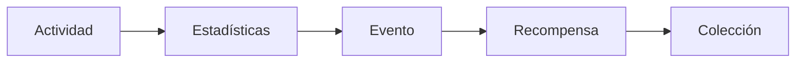

# Entrega de Progression Cycles

## Ejecutar la demostración

Abre PowerShell en la raíz de `entrega/progression-cycle` con LÖVE 11.5 instalado.

```powershell
& 'C:\Program Files\LOVE\love.exe' . --demo-progression
```

También puedes usar `love . --demo-progression` si el ejecutable está en el PATH. El menú muestra el día, las interacciones disponibles, el oro y las relaciones de Sylphie y Eris. El perfil comienza en el primer tiempo libre con el mazo inicial.

## Recorrido

1. Abre **Sylphie · Limpiar la casa** o **Eris · Entrenar con escudo** mediante clic o Tab y Enter.
2. Pulsa **Enter** para preparar las cartas. Elige una con **1–3** o clic y confirma con **Enter**. Compara el coste, la frase de Rudy y los cambios de amor y confianza en la reacción.
3. Pulsa **Enter** para avanzar. Después de la reposición, pulsa **P** para terminar la conversación o juega otra carta. Completar la actividad consume una interacción y muestra un recibo con el resultado, las estadísticas y los recursos.
4. Pulsa **Ver recompensa**. Tras la animación, abre **Ver resumen** y **Continuar** para volver al menú. Repite el recorrido con la otra actividad.
5. En **Colección y mejoras**, inspecciona **Escuchar** entre las cartas sociales. Abre **Combate**, avanza con **>** a la segunda página y elige **Defensa física**. **Mejorar** abre el detalle de nivel, copias y coste. Con la tercera interacción puedes repetir **Limpiar la casa** y conseguir otra copia para mejorar **Escuchar**.

| Actividad | Resultado material de la primera visita |
| --- | --- |
| S02 · Limpiar la casa | 12 de oro y una copia de **Escuchar**, que ya pertenece al mazo inicial. |
| E06 · Entrenar con escudo | **Defensa física** desbloqueada a nivel 1 y un material mágico. |

Amor y confianza dependen de las cartas que juegues, las respuestas escritas y el presupuesto diario. Los dos premios salen del catálogo y de las mismas reglas que usa la campaña.

## Arquitectura



| Responsabilidad | Archivo y comportamiento |
| --- | --- |
| Entrada | `src/demos/progression.lua` coloca a Rudy junto al personaje real y abre la actividad elegida. `src/screens/wife_activities.lua` recibe cartas, confirmaciones y cierre. |
| Actividades | `src/data/wife_activities.lua` registra las definiciones de Sylphie, Eris y Roxy en `src/data/wife_activities_sylphie.lua`, `src/data/wife_activities_eris.lua` y `src/data/wife_activities_roxy.lua`. `src/systems/wife_activities.lua` comprueba requisitos, calcula costes, resuelve respuestas y genera el recibo. |
| Reglas de progresión | `src/systems/daily.lua` reserva una interacción y la consume al finalizar. El estado compartido conserva día, visitas, presupuesto de relaciones y actividades concluidas. |
| Eventos | `src/systems/events.lua` aplica los cambios de estadísticas y economía y registra cada entrega con el identificador de instancia. El mismo identificador se aplica una sola vez. |
| Recompensa y colección | `src/systems/card_collection.lua` concede la carta original o sus duplicados y actualiza el desbloqueo. `src/systems/card_rewards.lua` prepara el estado de presentación de los recibos que generan los eventos. |
| Presentación | `src/screens/reward.lua` y `src/ui/reward_presentation.lua` animan el recibo después de la concesión. `src/screens/collection.lua`, `src/screens/combat_deck.lua` y `src/screens/upgrades.lua` muestran las cartas y permiten inspeccionar sus efectos y niveles. |

El diagrama sigue el recorrido del jugador. En código, `Events.apply` actualiza oro, relaciones, recursos y colección y agrega el recibo a la cola. La presentación lee esa cola. Completar la animación retira el recibo visual.

## Persistencia

LÖVE usa la identidad `cartas_del_destino_demo_progresion` y su propio `campaign-exploration-v1.json` con respaldo. **F5** guarda y **F9** guarda y abre el menú. Al abrir otra vez la demostración se recuperan el día, las relaciones, las interacciones, los recursos, las cartas y una actividad o adquisición en curso. **Continuar actividad o recompensa** retoma la pantalla pendiente. **Reiniciar recorrido** comienza una jornada académica nueva.

## Pruebas

```powershell
$env:DATESIM_TEST_MODULE = 'demo_progression'
./probar.ps1
$env:DATESIM_TEST_MODULE = 'card_rewards'
./probar.ps1
Remove-Item Env:DATESIM_TEST_MODULE
$env:DATESIM_TEST_GROUP = 'entrega_progresion'
./probar.ps1
Remove-Item Env:DATESIM_TEST_GROUP
```

La prueba `demo_progression` pasó **25 comprobaciones** y generó **8 capturas** en `tests/artifacts/demo-progression-*.png`. Completó las dos actividades, comprobó las estadísticas y recompensas, restauró una adquisición pendiente desde disco, rechazó una concesión repetida y abrió los detalles de la colección y las mejoras. Comparó byte a byte el guardado de control de campaña antes y después.

`card_rewards` pasó **289 comprobaciones** y generó **12 capturas**. Cubrió entregas individuales y agrupadas, duplicados y persistencia.

El arranque directo con `love.exe . --demo-progression` abrió la ventana **Ciclo de progresión**. La selección directa de `card_collection` mediante `DATESIM_TEST_MODULE` devolvió código 1 en esta rama y en el commit base, en la comprobación de grupos de cartas del mazo fijo del runner antiguo.

La suite general terminó con código 0 y `ALL TESTS PASSED` con la identidad de pruebas `entrega_progresion`. Incluyó 40 rutas de campaña, los cinco finales, especialización de cartas y guardado y carga.
