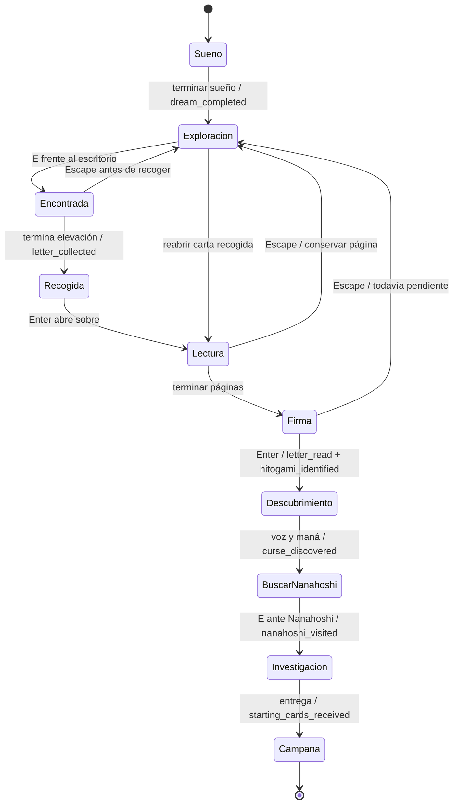

# Exploración 1: movimiento, mapas y prólogo

Implementado en el repositorio existente el 22 de noviembre de 2026 para LÖVE 11.5 / LuaJIT. No se movieron ni modificaron PNG, ASE, retratos o tilesets.

## Recorrido jugable

Nueva partida conserva el sueño original: `sueno_hitogami.png`, retrato japonés de Rudy, Hitogami, música y expresiones contextuales. El fundido blanco termina en `dormitorio_eris_map.png`, con Rudy rubio en `(112,112)`, junto a la cama y sobre suelo transitable. Aparece «Un nuevo día comienza en la casa Greyrat» y se entrega el control.

Eris, Roxy, Sylphie, Lilia, Aisha, Norn, Zenith y Lucy pueden recibir un saludo. Zenith lleva a Lucy en el sprite existente y responde por ambas en la misma interacción. Los saludos de Rudy son pensamientos y gestos; no reproducen voz física, no consumen espacios diarios ni modifican afinidad. Cliff, Zanoba y Nanahoshi también tienen saludos ambientales antes de la investigación. Los NPC conservan sus posiciones.

La carta `hitogami_letter` aparece únicamente en el escritorio del estudio, accesible por la cuarta puerta del segundo piso. Entrar no activa un evento. E inicia la recogida y eleva el recurso `15_nota_misteriosa` al centro de la pantalla. Enter abre el sobre; la lectura progresa por texto y páginas. Escape permite guardar la carta para después. La firma **—H** requiere una confirmación final. Solo entonces se registra la lectura y comienza la escena existente de recuerdo, pérdida de voz y magia fallida, sobre el estudio como fondo.

Al terminar esa escena, Rudy sigue en su posición y recibe el objetivo **Buscar a Nanahoshi en la Universidad de Ranoa**. Puede caminar por casa, jardín y Sharia, usar el traslado y entrar al laboratorio. La investigación y la entrega de cartas solo comienzan al interactuar con Nanahoshi. Los tutoriales, mazos, combates, actividades y capítulos anteriores siguen disponibles. Al regresar al control del mundo, **G** abre la agenda existente.

## Controles

| Control | En exploración |
| --- | --- |
| WASD / flechas | Caminar; diagonal normalizada |
| E | Interactuar con el objetivo cercano |
| Enter / Enter numérico | Confirmar diálogo, lectura o traslado |
| Escape | Pausa; cerrar un panel o carta sin terminar su lectura |
| M | Minimapa; pausa el movimiento |
| I | Inventario; Enter abre la carta recogida; C abre la colección tras recibir cartas |
| J | Diario, objetivo y relectura |
| Tab | Estado diario y relaciones |
| F5 | Guardar |
| F11 | Pantalla completa |
| G | Agenda y campaña tras el tutorial; desde la agenda, volver al mundo |

Dentro de los sistemas anteriores se mantienen sus controles contextuales: M abre mazos en escenas narrativas y E termina turnos en combate. El inventario del mundo ofrece acceso a la misma colección.

## Estados del prólogo



`letter_found` no equivale a `letter_collected`, y ninguna equivale a `letter_read`. Cargar o acercarse a una puerta nunca sustituye la confirmación. Releer no repite eventos ni recompensas. Las flags son independientes del inventario de cartas jugables.

## Mapas, colisión y cámara

- Se conservan los 13 enlaces y 26 portales originales; 24 portales físicos habilitados. El estudio solo conecta con el segundo piso y el patio solo con el jardín.
- El muro de la universidad sigue cerrado. Hay un traslado explícito y reversible desde Sharia `(672,160)` a universidad `(80,164)` y desde universidad `(64,164)` a Sharia `(648,160)`, con confirmación y fundido. [Auditoría y coordenadas](MAPAS_CONEXIONES.md).
- Huella de Rudy: 12 × 8 anclada en los pies. Paredes, muebles y obstáculos prevalecen sobre suelo. Los NPC también son sólidos. La unión de regiones transitables evita costuras artificiales.
- Movimiento a 76 píxeles originales/segundo, con subpasos de hasta 2 píxeles y resolución por ejes; impide atravesar obstáculos con diagonales o un `dt` grande.
- Rudy usa la hoja existente de 96 × 128, cuatro direcciones y cuatro cuadros de 24 × 32. Reposo en cuadro cero, caminar cada 100 ms; NPC familiares usan sus animaciones existentes.
- Canvas 640 × 360; ventana del mundo de 320 × 152 ampliada uniformemente 2×. Cámara y coordenadas de dibujo enteras, filtro nearest y límites del PNG. Las habitaciones pequeñas quedan dentro del viewport sin mostrar zonas externas.
- El minimapa deriva del suelo, portales habilitados, NPC, viaje y posición real. Resalta el siguiente acceso hacia el objetivo y conserva los lugares visitados. No dibuja el portal desactivado.

## Archivos

| Módulo nuevo | Función |
| --- | --- |
| `src/data/exploration_world.lua` | Inicio, NPC, saludos, carta, recurso y traslados |
| `src/systems/prologue.lua` | Estados, objetivos, lectura, visita y restauración |
| `src/systems/exploration.lua` | Movimiento, sólidos, portales, alcance, cámara y marcadores |
| `src/screens/exploration.lua` | Render del mundo, controles, saludos y paneles |
| `src/screens/exploration_letter.lua` | Elevación, apertura, páginas, firma y relectura |
| `tests/exploration.lua` | Pruebas físicas, narrativa, persistencia y capturas |
| `tests/exploration_driver.lua` | Recorrido por rutas reales para integración de campaña |

Archivos modificados: `src/app.lua`, `src/config/controls.lua`, `src/data/maps.lua`, `src/data/map_collisions.lua`, `src/data/chapters/day1.lua`, `src/systems/map_validation.lua`, `src/systems/progression.lua`, `src/systems/save.lua`, `src/screens/dialogue.lua`, `src/screens/agenda.lua`, `tests/run.lua`, `tests/exploration_assets.lua`, `tests/portraits.lua`, `tests/restructure_integration.lua`; documentación en `README.md`, `docs/MAPAS_CONEXIONES.md`, `docs/GUARDADO.md`, `docs/MANUAL.md`, `docs/VERIFICACION.md` y este informe. Los catálogos `exploration_assets.lua` y `map_connections.lua` se reutilizan sin reescribirlos.

## Evidencias

Capturas producidas por el renderer real de LÖVE y revisadas visualmente. Se regeneran con la prueba `exploration` y quedan en `tests/artifacts/`, excluidas de Git por la configuración existente.

| Captura | Archivo |
| --- | --- |
| Sueño | [play-dream.png](../tests/artifacts/play-dream.png) |
| Despertar en dormitorio de Eris | [play-eris-bedroom.png](../tests/artifacts/play-eris-bedroom.png) |
| Saludo gratuito a Eris | [play-family-greeting.png](../tests/artifacts/play-family-greeting.png) |
| Segundo piso y sus puertas | [play-second-floor.png](../tests/artifacts/play-second-floor.png) |
| Exploración de planta baja | [play-house.png](../tests/artifacts/play-house.png) |
| Carta en el escritorio del estudio | [play-study-letter.png](../tests/artifacts/play-study-letter.png) |
| Sobre recogido | [play-letter-envelope.png](../tests/artifacts/play-letter-envelope.png) |
| Lectura | [play-letter-reading.png](../tests/artifacts/play-letter-reading.png) |
| Firma —H | [play-letter-signature.png](../tests/artifacts/play-letter-signature.png) |
| Voz y maná bloqueados | [play-mana-sealed.png](../tests/artifacts/play-mana-sealed.png) |
| Universidad | [play-university.png](../tests/artifacts/play-university.png) |
| Minimapa | [play-minimap.png](../tests/artifacts/play-minimap.png) |

## Pruebas

```powershell
# Recorrido nuevo y capturas, con identidad de guardado aislada
$env:DATESIM_TEST_MODULE = 'exploration'
./probar.ps1
Remove-Item Env:DATESIM_TEST_MODULE
# Suite completa, incluidos sistemas anteriores
./probar.ps1
```

La suite nueva cubre los 24 puntos de aceptación: sueño y apariencia; inicio y salida de Eris; rutas de toda la casa; saludos gratuitos; bloqueo previo a la lectura; carta, apertura y firma; cierre incompleto; descubrimientos; objetivo y camino a Nanahoshi; colisión, regreso y minimapa; guardado en ambos estados; eventos únicos e integración con la entrega de cartas. La búsqueda física de rutas comprueba todos los accesos, NPC y objetos de los 14 mapas usando los sólidos reales.

### Resultados ejecutados

| Ejecución | Resultado |
| --- | --- |
| Suite completa `lovec.exe . --test` | **ALL TESTS PASSED**, salida 0; [registro](../tests/artifacts/exploration-full-suite.log) |
| Campaña simulada incluida en la suite | 28 848 comprobaciones; 40 rutas completas y cinco finales con/sin Orsted |
| Integración por pantallas incluida en la suite | 1 472 comprobaciones; 835 pasos desde Nueva partida hasta el final, incluido el nuevo recorrido físico |
| Regresión de combate incluida en la suite | 576 simulaciones de jefes, además de entrenamiento y combate ordinario |
| Exploración después de los últimos ajustes de objetivo y aviso de despertar | **770 comprobaciones**, 14 mapas y 12 capturas; **ALL TESTS PASSED**, salida 0; [registro](../tests/artifacts/exploration-focused.log) |
| Catálogo y topología incluidos en la suite | 3 707 comprobaciones de assets/mapas/conexiones |
| `python tools/migrate_exploration_assets.py verify` | 109 archivos migrados y 157 anteriores conservados; bytes ASE intactos |
| `git diff --check` | Sin errores de espacios; avisos de conversión LF/CRLF según la configuración local |

La ejecución completa incluye las pruebas anteriores de recursos, movimiento, retratos, opciones/audio, matrimonios, economía, familia, agenda, combate, entrenamiento, capítulos finales, afinidad, maldición, diálogos ramificados e integración. Las pruebas antiguas que esperaban un diálogo al despertar se actualizaron para comprobar el nuevo mapa y navegar por las rutas reales. Se conservó la prueba del documento anterior para las campañas previas.

## Pendientes y alcance

1. Editar gráficamente una abertura en la universidad y recalibrar el enlace Sharia–Universidad; el traslado explícito permite completar la campaña mientras tanto.
2. El suelo revisado cubre las rutas jugables y las interacciones. Algunas áreas decorativas exteriores y detrás de mobiliario siguen bloqueadas de forma conservadora.
3. Las actividades profundas, la gestión de mazos y los capítulos posteriores mantienen sus pantallas anteriores, accesibles desde la agenda. No se trasladó toda la campaña de siete días al mundo físico.
4. Los 18 avisos preexistentes de capas ASE de mapas/tilesets siguen documentados en la auditoría de assets; no se modificaron sus binarios.
5. Se verificaron renderizado y reproducción de efectos por pruebas; queda una sesión de juego y escucha manual prolongada para evaluar ritmo y comodidad.
