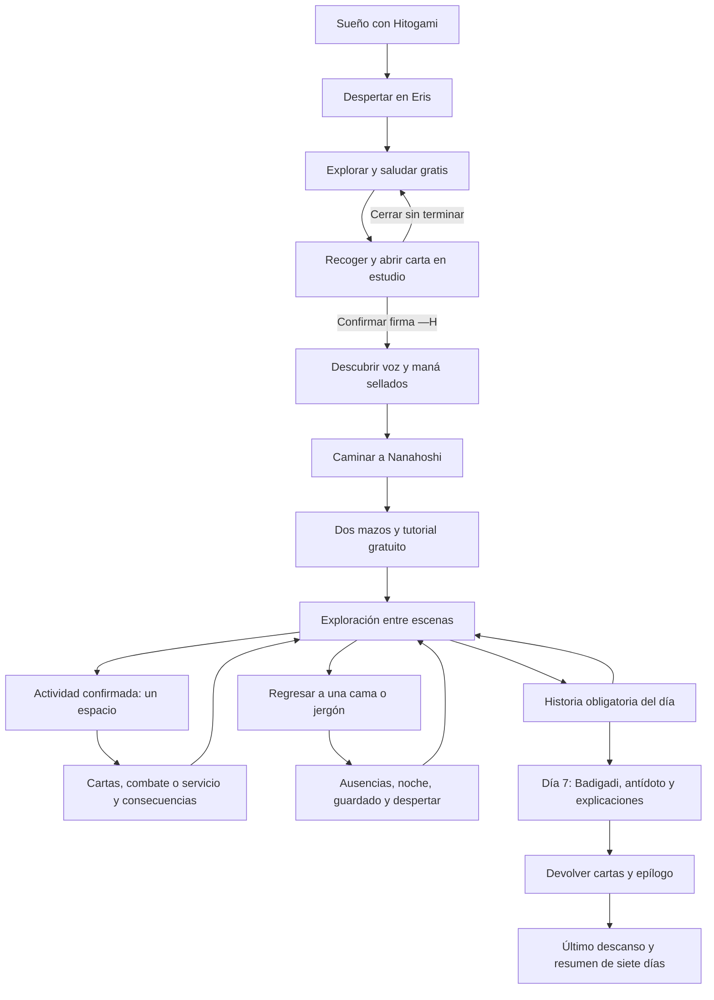

# Exploración 4 — Campaña integrada

22 de noviembre de 2026. Implementación sobre el repositorio existente, para Windows con LÖVE 11.5 y LuaJIT. No se reorganizaron ni modificaron los PNG/ASE. Esta entrega conecta y verifica los sistemas de exploración 1–3 con los capítulos, cartas y combates existentes.

## Sistemas completados y recorrido

El sueño utiliza la apariencia japonesa de Rudy. Despierta con su sprite rubio en el dormitorio de Eris. Caminar, saludar y entrar al estudio no avanzan la investigación: hay que recoger la carta y confirmar su lectura hasta **—H**. Puede cerrarse, dejarse pendiente y consultarse desde el diario. La pérdida de voz y el bloqueo de maná llevan al objetivo de Nanahoshi; se llega caminando y usando el traslado explícito de Sharia. Sólo después de sus cinco cartas sociales, cinco físicas y tutorial se habilitan las actividades.

Las 45 actividades, saludos familiares, hallazgos diarios, compras, mejoras, encargos y descanso funcionan entre las escenas de la campaña. Las actividades regresan a las coordenadas originales. Las escenas principales son independientes de los placements: Cliff puede intervenir en una investigación sin abandonar permanentemente su NPC del taller. Las expediciones narrativas a bosque y ruinas usan los escenarios existentes.

| Día | Integración principal |
|---|---|
| 1 | Sueño, exploración libre, lectura personal, maldición, Nanahoshi y tutorial; después tres espacios |
| 2 | Cartas prestadas, responsabilidades, promesas, investigaciones y combate opcional |
| 3 | Bosque y ruinas, fragmento instalado en el artefacto, primeras técnicas mágicas |
| 4 | Investigación privada con Cliff/Nanahoshi, emisario, conflictos y progresión |
| 5 | Misiones personales, duelo con Eris, compromisos, reconciliaciones o separaciones |
| 6 | Vencer al emisario revela a Badigadi; Orsted aparece sólo con entrenamiento en cada fecha 1–5 |
| 7 | Preparación y guardado, Badigadi de 1000 PV, antídoto, voz/maná recuperados, familia y devolución de cartas |

Orsted reconoce los artefactos de Nanahoshi. Su combate termina en una derrota narrativa no letal; el comentario distingue entre defenderse únicamente y combinar ataque y protección. Entrega patrones faltantes y una mejora social y otra de combate a nivel 10, sin coste. Es opcional.

Badigadi mantiene sus cuatro fases, seis brazos, resistencia y sello final. Puede vencerse sin esposas y sin Orsted. No muere al entregar el antídoto. Hitogami no se convierte en un enemigo físico: el emisario ejecutó el engaño. La identidad del custodio de la cura no se revela antes de vencer al emisario.

## Mapas y acceso

| Zona | Mapas funcionales (IDs internos) |
|---|---|
| Casa | `casa_planta_baja`, `casa_segundo_piso`, `dormitorio_sylphie`, `dormitorio_roxy`, `dormitorio_eris`, `estudio_rudy`, `jardin_casa`, `patio_eris` |
| Sharia | `camino_sharia`, `cementerio_ranoa` |
| Universidad | `universidad_exterior`, `biblioteca_ranoa`, `taller_cliff_zanoba`, `laboratorio_nanahoshi` |

Se conservan **14 mapas, 13 conexiones registradas y 26 portales**. Hay 12 enlaces físicos activos (24 portales) y un enlace físico desactivado. El traslado Sharia–Universidad añade ida y vuelta explícitas, con transición, sin atravesar el muro. El patio conecta únicamente con el jardín; el estudio, únicamente con el segundo piso. Las colisiones usan los pies, normalización diagonal y pasos cortos. Cámara y minimapa derivan de los mismos datos.

## Actividades, NPC y relaciones

Cada esposa tiene 15 actividades: **E01–E15, R01–R15 y S01–S15**. Hay **165 respuestas contextuales**, compatibles en conjunto con las **21 cartas sociales**, además de las conversaciones de los capítulos. El [informe de cobertura](COBERTURA_ACTIVIDADES.md) enumera cada actividad, carta, respuesta y recompensa. Las opciones rotan y el catálogo completo conserva accesibles los requisitos de progresión.

Lilia, Aisha, Norn, Zenith y Lucy tienen al menos ocho reacciones; Zenith y Lucy comparten un sprite. Los saludos no consumen espacios ni conceden amor/confianza. Los hallazgos diarios son 1–3 instancias con semilla y posiciones válidas. Los encargos de Cliff/Zanoba cuestan oro, pueden fallar y no cambian de resultado al cargar. Roxy requiere confirmación para compras reales.

Una actividad confirmada consume uno de tres espacios compartidos. El límite diurno es +10 por esposa y estadística. Una ausencia resta 20/20 una vez; el descanso ofrece hasta +10/+10 por separado y no sustituye la visita. Se despierta en el dormitorio elegido. Hay jergón si Rudy duerme solo. Las separaciones persisten, deshabilitan romance y compañía, y se muestran mediante despedida, anillo y caballo. Sylphie se marcha con Lucy.

## Resumen con datos reales

La pantalla `campaign_summary.lua` se abre automáticamente al completar la última jornada después del epílogo. Ofrece General y una pestaña por esposa, recuerdos paginados, enlace al final, diario y colección. Los retratos de esposas separadas permanecen grises.

| Dato | Fuente |
|---|---|
| Amor/confianza inicial y final | Valores iniciales observados en `campaignStats`; relaciones actuales |
| Días visitada e interacciones | Visitas de los siete registros diarios, sin contar saludos ni noches |
| Noches compartidas | Registros únicos de `rest.nights` |
| Promesas cumplidas/incumplidas | IDs de promesas y su historial; una reparación no borra el incumplimiento |
| Reconciliaciones | Conflictos pendientes que se resolvieron; un efecto repetido vacío no suma |
| Combates compartidos | Compañeras presentes en intentos concluidos, incluidas derrotas |
| Recuerdos y estado matrimonial | Diario y relaciones persistidas |
| Oro ganado/gastado | Recibos reales; el capital inicial de 120 no es ingreso ganado |
| Cartas y copias obtenidas | Colección; copias actuales más copias consumidas en mejoras |
| Niveles mejorados y nivel 10 | Niveles reales de colección, incluidas mejoras gratuitas de Orsted |
| Enemigos vencidos y derrotas | Registro por intento; reintentar no borra pérdidas, cargar no duplica |
| Entrenamiento y Orsted | Categorías separadas de los enemigos derrotados |
| Encargos | Resultados entregados de las inversiones, sin premiar pendientes |
| Hallazgos | IDs recogidos, excluida la carta narrativa |
| Fragmentos | Stock, consumos registrados y el fragmento narrativo instalado del Día 3 |
| Orsted, antídoto y final | Eventos concluidos y resolución matrimonial real |

Las partidas anteriores sin registro de combates siguen cargando, pero el resumen informa que sólo contiene los intentos registrados desde esta versión. Un valor inicial no documentado se muestra como **Sin registro**, sin inferirlo de la puntuación final. El archivo de campaña anterior no se sobrescribe.

## Cinco finales

Se mantienen exactamente Familia Greyrat unida, Solo Roxy, Solo Eris, Solo Sylphie y Rudy solo. Se evalúan matrimonios, compromisos, misiones, conflictos y decisiones. Si quedan dos relaciones viables, las conversaciones de proyectos y despedidas permiten resolverlas explícitamente; no se elige automáticamente la puntuación mayor. La cura no resucita relaciones perdidas.

## Archivos de esta integración

| Tipo | Archivos |
|---|---|
| Módulos nuevos | `src/systems/campaign_stats.lua`, `src/screens/campaign_summary.lua` |
| Integración y persistencia | `src/app.lua`, `src/screens/summary.lua`, `src/screens/combat.lua`, `src/systems/progression.lua`, `src/systems/daily.lua`, `src/systems/wife_activities.lua`, `src/systems/save.lua` |
| Guía dentro del juego | `src/data/manual.lua` |
| Pruebas nuevas | `tests/campaign_stats.lua`, `tests/campaign_world_driver.lua`, `tests/campaign_integration.lua` |
| Pruebas ampliadas | `tests/campaign.lua`, `tests/finale.lua`, `tests/run.lua` |
| Documentación | README, MANUAL, GUARDADO, SISTEMAS, COMBATE, CAPITULOS, ANIMACIONES, MAPAS_CONEXIONES, VERIFICACION, este informe y AMPLIAR_CONTENIDO |

Los archivos de exploración, objetos y actividades creados en las fases anteriores se detallan en [fase 1](EXPLORACION_FASE_1.md), [fase 2](EXPLORACION_FASE_2.md) y [fase 3](EXPLORACION_FASE_3.md). Permanecen en este mismo árbol de trabajo.

## Controles

| Tecla | Acción |
|---|---|
| WASD / flechas | Caminar |
| E | Saludar, examinar, entrar en actividad o descansar |
| Enter | Confirmar; abrir/avanzar carta y diálogos |
| Escape | Cerrar lectura/menú o pausar |
| M / I / J / Tab | Minimapa / inventario / diario / estado y relaciones |
| G | Agenda y continuación narrativa desde exploración |
| F5 | Guardar |
| 1–4 en resumen | General / Sylphie / Roxy / Eris |

## Capturas del renderizador real

Todas provienen del canvas del juego; no son composiciones ni ilustraciones nuevas. Los artefactos quedan en `tests/artifacts/` y se regeneran con las suites.

| Evidencia | Captura |
|---|---|
| Despertar | [Dormitorio de Eris](../tests/artifacts/play-eris-bedroom.png) |
| Casa y estudio | [Exploración](../tests/artifacts/play-house.png) · [Carta en escritorio](../tests/artifacts/play-study-letter.png) |
| Lectura y mapa | [Firma —H](../tests/artifacts/play-letter-signature.png) · [Minimapa](../tests/artifacts/play-minimap.png) |
| Familia | [Lilia limpiando](../tests/artifacts/world2-lilia-cleaning-1.png) · [Aisha](../tests/artifacts/world2-aisha.png) · [Zenith y Lucy](../tests/artifacts/world2-zenith-lucy.png) |
| Objetos e inversiones | [Hallazgo](../tests/artifacts/world2-hidden-find.png) · [Éxito](../tests/artifacts/world2-commission-success.png) · [Fracaso](../tests/artifacts/world2-commission-failure.png) |
| Cementerio | [Paul](../tests/artifacts/world2-cemetery-paul.png) · [Oldeus](../tests/artifacts/world2-cemetery-oldeus.png) |
| Actividades | [Opciones de Eris](../tests/artifacts/wives-eris-offers.png) · [Carta de Sylphie](../tests/artifacts/wives-sylphie-card-preview.png) · [Compra de Roxy](../tests/artifacts/wives-roxy-purchase-confirm.png) |
| Noche y separación | [Descanso](../tests/artifacts/wives-rest-confirm.png) · [Despertar en Roxy](../tests/artifacts/wives-roxy-next-morning.png) · [Caballo y Lucy](../tests/artifacts/family-horse-sylphiette.png) |
| Jefes | [Orsted](../tests/artifacts/finale-orsted-narrative-defeat.png) · [Seis brazos](../tests/artifacts/combat-badigadi-six_arms.png) · [Victoria](../tests/artifacts/combat-badigadi-victory.png) |
| Cierre | [Devolver cartas](../tests/artifacts/finale-return-cards.png) · [Resumen familiar](../tests/artifacts/campaign-A-summary.png) · [Estadísticas de Eris](../tests/artifacts/campaign-A-wife-3.png) · [Recuerdos](../tests/artifacts/campaign-A-memories.png) |
| Los otros desenlaces | [Eris](../tests/artifacts/campaign-B-summary.png) · [Roxy](../tests/artifacts/campaign-C-summary.png) · [Sylphie](../tests/artifacts/campaign-D-summary.png) · [Solo](../tests/artifacts/campaign-G-summary.png) |
| Separación en el resumen | [Retrato gris e historial conservado](../tests/artifacts/campaign-G-separated.png) |

## Pruebas y reproducibilidad

Los [resultados de verificación](VERIFICACION.md) contienen cantidades y registros de la ejecución. `tests/campaign_integration.lua` amplía el conductor de las campañas anteriores con prólogo, movimiento por colisiones reales, carta mediante su pantalla, saludos, actividades E/R/S, botín, inversiones y descanso físico. No inyecta puntos afectivos para fabricar un final. Revalida el guardado entre pasos. El combate usa acciones legales del motor.

La suite completa pasó **40 campañas anteriores + nueve explorables**. La comprobación final de A–I pasó **7.067 comprobaciones y produjo 14 capturas**; el módulo de estadísticas pasó **22 comprobaciones**. Todas terminaron con salida 0 y `ALL TESTS PASSED`. Se revisaron visualmente el resumen general, las cifras por esposa, los recuerdos paginados y el retrato gris. No quedaron bloqueos observados en estos recorridos.

| Partida | Semilla | Estrategia y desenlace comprobado |
|---|---:|---|
| A | 117 | Visitas equilibradas, noches rotatorias: familia unida |
| B | 218 | Concentración en Eris: solo Eris |
| C | 319 | Concentración en Roxy: solo Roxy |
| D | 420 | Concentración en Sylphie: solo Sylphie |
| E | 521 | Pierde un vínculo; decide explícitamente entre los dos viables: Roxy |
| F | 622 | Pierde dos vínculos: Sylphie |
| G | 723 | Negligencia, tres separaciones, viajes y descanso solo: Rudy solo |
| H | 824 | Familia equilibrada sin los cinco entrenamientos: unida sin Orsted |
| I | 925 | Entrenamiento en cada fecha 1–5: unida con regalos de Orsted |

Cada ejecución escribe `campaign-A.json` … `campaign-I.json`, con semilla, sesión final y estadísticas. `campaign-integration-results.json` conserva las métricas de combate de los nueve recorridos. [Comandos y guía para añadir contenido](AMPLIAR_CONTENIDO.md).

## Pendientes y límites

- El acceso físico Sharia–Universidad sigue cerrado en el PNG original. El traslado bidireccional es la solución provisional explícita y permite completar la campaña. La solución gráfica definitiva requiere editar ese mapa en una fase futura.
- El verificador conserva 18 avisos preexistentes de cabecera de capas ASE. Los bytes originales no se alteraron; esto no impide usar los PNG en LÖVE.
- Los guardados anteriores no contienen todos los intentos de combate. El resumen señala esa ausencia; no se pueden reconstruir derrotas históricas que nunca se guardaron.
- Las expediciones a bosque y ruinas son escenas y combates sobre los fondos existentes; el mundo caminable conserva los 14 mapas pedidos. La música es la síntesis original del gestor existente.

La evidencia corresponde a pruebas automatizadas y capturas revisadas del renderizador real. No se presenta como una sesión manual de juego humano completa ni como una medición de FPS en hardware distinto del entorno de pruebas.
