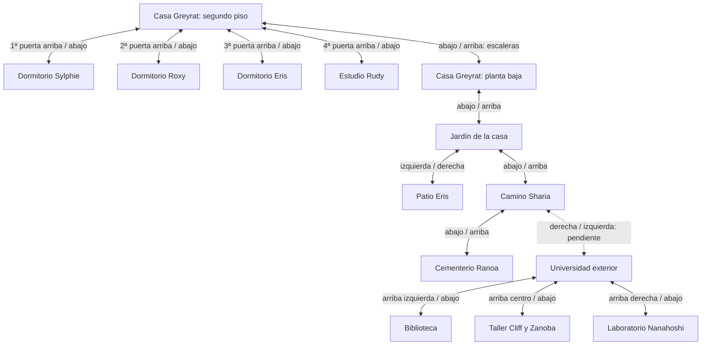

# Mapas explorables y conexiones

## Corrección social: colisiones y horarios

La huella de pies es ahora 10 × 6. Se redujeron las mesas de la sala/comedor/biblioteca a su volumen real, se liberaron sillas, sillones y plantas pequeñas y los faroles conservan bases de 8 × 8. Las paredes, camas y demás sólidos siguen bloqueados; se validaron los portales existentes.

Eris aparece de día en `patio_eris` (360,216), Roxy en `biblioteca_ranoa` (200,216) y Sylphie en `casa_planta_baja` (196,172). Tras cerrar tres actividades pasan a sus dormitorios; no hay duplicados y el minimapa usa la presencia actual. [Datos exactos, excepciones del prólogo y guardado](COLISIONES_NPC.md).

Revisión visual de los 14 PNG originales: 22 de noviembre de 2026. La fase de exploración 1 reutiliza este registro e incorpora movimiento, cámara, interacción y prólogo. Los PNG y ASE originales se conservan.

La integración de exploración 4 utiliza este mismo grafo. Sus simulaciones caminan sobre las colisiones reales hacia el estudio, Nanahoshi, los NPC, hallazgos y camas; recorren el traslado de ida y vuelta. Las escenas de expedición a bosque/ruinas utilizan los fondos y encuentros narrativos existentes, sin añadir mapas ni mover permanentemente los NPC de sus ubicaciones habituales. [Pruebas y guía de extensión](EXPLORACION_FASE_4.md).

## Estado del mundo

**14 mapas, 13 conexiones bidireccionales, 26 portales dirigidos.** Todos los mapas son alcanzables desde `casa_planta_baja` en el grafo previsto. Se calibraron 25 extremos de acceso; 12 enlaces completos (24 portales) están marcados como calibrados. Un enlace y sus dos portales están desactivados por calibración pendiente.

**Incidencia visual:** el borde izquierdo de `universidad_exterior_map.png` presenta un muro y postes continuos; el camino horizontal termina contra ellos. No se identifica una abertura. `sharia_universidad.b` usa `status="pending_calibration"`, `trigger=false`, `spawn=false`. Su extremo de Sharia sí está identificado, pero ambos sentidos del enlace físico permanecen desactivados. La fase 1 incorpora el traslado explícito descrito a continuación para llegar a la universidad y sus tres interiores.

Los mapas tienen `explorationReady=true` y colisiones `routes_reviewed`. Las rutas de los accesos, los NPC y los objetos se prueban mediante búsqueda sobre la huella de pies real, incluyendo sólidos de NPC. El suelo no revisado sigue bloqueado.

### Solución provisional Sharia–Universidad

El enlace físico `sharia_universidad` y sus dos portales siguen desactivados, sin alterar sus coordenadas originales. El grafo de portales habilitados conserva diez mapas alcanzables desde casa. `src/data/exploration_world.lua` añade dos **puntos de traslado interactivos**, identificados con una T en el mundo y en lila en el minimapa:

| Origen y punto | Llegada | Interacción |
| --- | --- | --- |
| Sharia `(672,160)` | Universidad `(80,164)`, mirando a la derecha | E, luego Enter para viajar |
| Universidad `(64,164)` | Sharia `(648,160)`, mirando a la izquierda | E, luego Enter para viajar |

Ambos puntos y sus llegadas están sobre el camino revisado; el viaje usa un fundido. La ruta combinada alcanza los 14 mapas. No hay una puerta en el muro ni un teletransporte narrativo al laboratorio. La solución definitiva requiere editar gráficamente el acceso y recalibrarlo en una fase futura.

## Los catorce mapas

Los IDs no incluyen `_map`; el sufijo permanece en el nombre real del archivo PNG/ASE. Las dimensiones son originales. Música: IDs existentes de `src/data/audio.lua`, sin rutas inventadas.

| ID | Nombre | PNG (px) | Categoría | Tileset | Inicio (pies) | Música | NPC disponibles |
| --- | --- | --- | --- | --- | --- | --- | --- |
| `casa_planta_baja` | Casa Greyrat - Planta baja | 640 × 384 | `greyrat_house` | `hogar` | (320, 304), abajo | `home` | aisha, lilia, norn, zenith, lucy |
| `casa_segundo_piso` | Casa Greyrat - Segundo piso | 512 × 320 | `greyrat_house` | `hogar` | (256, 208), abajo | `home` | — |
| `dormitorio_sylphie` | Dormitorio de Sylphie | 320 × 192 | `greyrat_house` | `hogar` | (160, 160), abajo | `home` | sylphiette |
| `dormitorio_roxy` | Dormitorio de Roxy | 320 × 192 | `greyrat_house` | `hogar` | (160, 160), abajo | `home` | roxy |
| `dormitorio_eris` | Dormitorio de Eris | 320 × 192 | `greyrat_house` | `hogar` | (160, 160), abajo | `home` | eris |
| `estudio_rudy` | Estudio de Rudy | 320 × 192 | `greyrat_house` | `hogar` | (160, 160), abajo | `home` | — |
| `jardin_casa` | Jardín de la casa Greyrat | 512 × 320 | `greyrat_house` | `exterior` | (232, 152), abajo | `home` | aisha, lilia, norn, zenith, lucy |
| `patio_eris` | Patio de entrenamiento de Eris | 640 × 384 | `greyrat_house` | `exterior` | (320, 216), abajo | `training` | eris |
| `camino_sharia` | Camino de Sharia | 768 × 320 | `sharia` | `exterior` | (384, 168), abajo | `casual` | — |
| `cementerio_ranoa` | Cementerio de Ranoa | 512 × 320 | `sharia` | `cementerio` | (256, 80), abajo | `mystery` | — |
| `universidad_exterior` | Universidad de Ranoa - Exterior | 640 × 384 | `ranoa` | `universidad` | (332, 168), abajo | `university` | — |
| `biblioteca_ranoa` | Biblioteca de Ranoa | 512 × 320 | `ranoa` | `universidad` | (256, 208), abajo | `university` | roxy |
| `taller_cliff_zanoba` | Taller de Cliff y Zanoba | 512 × 320 | `ranoa` | `universidad` | (256, 208), abajo | `university` | cliff, zanoba |
| `laboratorio_nanahoshi` | Laboratorio de Nanahoshi | 512 × 320 | `ranoa` | `universidad` | (256, 248), abajo | `mystery` | nanahoshi |

Los NPC son candidatos disponibles para futura autoría. `placements={}` y `objects={}` no activan personajes ni objetos en posiciones arbitrarias; su ubicación queda pendiente. Planta baja representa sala, cocina, comedor y zona familiar. Los objetos individuales/atlas están listos para asignarse cuando se definan interacciones.

## Diagrama exacto

Cada línea representa una conexión bidireccional. La línea discontinua conserva el enlace previsto, pendiente de acceso visible en la universidad.



No existe conexión planta baja–patio. Jardín sólo conecta con casa, patio y Sharia; patio sólo con jardín; cementerio sólo con Sharia. Las habitaciones superiores salen por abajo al segundo piso. Biblioteca, taller y laboratorio salen por abajo a la universidad.

## Coordenadas de activación y llegada

Origen `(0,0)` arriba a la izquierda del PNG; medidas en píxeles originales, independientes de ventana/cámara/escala. Las zonas usan `{x,y,w,h}`. Los puntos `{x,y,facing}` indican **centro de los pies** de Rudy: un sprite 24 × 32 se dibuja en `(x-12,y-32)`. Su huella de colisión es 12 × 8, desde `(x-6,y-8)`. Se comprueban pies y límites de imagen; un sprite puede superponerse visualmente a una pared por su altura, sin situar los pies dentro de ella.

`top/bottom/left/right` identifica el lado del acceso; una puerta en la pared superior puede estar dentro de la imagen y no en y=0. `down/left/right/up` identifica la orientación del personaje. Al llegar mira hacia el interior. Las llegadas están fuera de las zonas de activación para evitar un regreso inmediato.

En cada fila, la llegada A se usa al viajar **B → A**, y la llegada B al viajar **A → B**. Todas las transiciones son `fade`. Las coordenadas son configurables exclusivamente en `src/data/map_connections.lua`.

| Enlace | Extremo A / lado | Zona A | Llegada A / orientación | Extremo B / lado | Zona B | Llegada B / orientación | Estado |
| --- | --- | --- | --- | --- | --- | --- | --- |
| `segundo_sylphie` | `casa_segundo_piso/puerta_sylphie` · arriba | (100, 116, 24, 12) | (112, 144), abajo | `dormitorio_sylphie/salida` · abajo | (148, 172, 24, 12) | (160, 160), arriba | Calibrado |
| `segundo_roxy` | `casa_segundo_piso/puerta_roxy` · arriba | (196, 116, 24, 12) | (208, 144), abajo | `dormitorio_roxy/salida` · abajo | (148, 176, 24, 12) | (160, 160), arriba | Calibrado |
| `segundo_eris` | `casa_segundo_piso/puerta_eris` · arriba | (292, 116, 24, 12) | (304, 144), abajo | `dormitorio_eris/salida` · abajo | (148, 172, 24, 12) | (160, 160), arriba | Calibrado |
| `segundo_estudio` | `casa_segundo_piso/puerta_estudio` · arriba | (380, 116, 24, 12) | (392, 144), abajo | `estudio_rudy/salida` · abajo | (148, 176, 24, 12) | (160, 160), arriba | Calibrado |
| `escaleras_casa` | `casa_segundo_piso/escaleras` · abajo | (232, 280, 48, 16) | (256, 248), arriba | `casa_planta_baja/escaleras` · arriba | (360, 104, 24, 16) | (372, 144), abajo | Calibrado |
| `casa_jardin` | `casa_planta_baja/puerta_principal` · abajo | (300, 352, 40, 12) | (320, 336), arriba | `jardin_casa/entrada_casa` · arriba | (220, 72, 24, 16) | (232, 104), abajo | Calibrado |
| `jardin_patio` | `jardin_casa/paso_patio` · izquierda | (0, 192, 16, 32) | (40, 216), derecha | `patio_eris/paso_jardin` · derecha | (624, 192, 16, 32) | (600, 216), izquierda | Calibrado |
| `jardin_sharia` | `jardin_casa/salida_sharia` · abajo | (220, 304, 24, 16) | (232, 280), arriba | `camino_sharia/paso_jardin` · arriba | (216, 0, 24, 16) | (228, 48), abajo | Calibrado |
| `sharia_cementerio` | `camino_sharia/paso_cementerio` · abajo | (368, 304, 24, 16) | (384, 280), arriba | `cementerio_ranoa/salida_sharia` · arriba | (240, 0, 32, 16) | (256, 48), abajo | Calibrado |
| `sharia_universidad` | `camino_sharia/paso_universidad` · derecha | (752, 144, 16, 32) | (696, 160), izquierda | `universidad_exterior/paso_sharia` · izquierda | Pendiente | Pendiente | Desactivado; pendiente |
| `universidad_biblioteca` | `universidad_exterior/puerta_biblioteca` · arriba | (144, 88, 24, 16) | (156, 120), abajo | `biblioteca_ranoa/salida` · abajo | (240, 296, 32, 16) | (256, 272), arriba | Calibrado |
| `universidad_taller` | `universidad_exterior/puerta_taller` · arriba | (320, 88, 24, 16) | (332, 120), abajo | `taller_cliff_zanoba/salida` · abajo | (240, 296, 32, 16) | (256, 272), arriba | Calibrado |
| `universidad_laboratorio` | `universidad_exterior/puerta_laboratorio` · arriba | (500, 88, 24, 16) | (512, 120), abajo | `laboratorio_nanahoshi/salida` · abajo | (240, 296, 32, 16) | (256, 272), arriba | Calibrado |

### Evidencia visual de cada acceso

Los nombres de puertas y sus colores fijan el orden, sin deducirlo de coordenadas aleatorias. Las capturas de QA se generan con `tests/exploration_visual.lua`: azul translúcido = suelo revisado, verde = huella de pies, amarillo = activación, naranja = extremo conocido de un enlace pendiente. No se dibuja un portal inventado en el muro de la universidad.

| Enlace | Evidencia en A | Evidencia en B |
| --- | --- | --- |
| `segundo_sylphie` | Primera puerta superior, paño verde; suelo delante del umbral. | Hueco inferior central entre jambas. |
| `segundo_roxy` | Segunda puerta superior, paño azul; suelo delante del umbral. | Hueco inferior central entre jambas. |
| `segundo_eris` | Tercera puerta superior, paño rojo; suelo delante del umbral. | Hueco inferior central entre jambas. |
| `segundo_estudio` | Cuarta puerta superior, paño ocre; suelo delante del umbral. | Hueco inferior central entre jambas. |
| `escaleras_casa` | Escalera inferior central entre las dos barandas. | Base de la escalera superior, a la derecha del recibidor. |
| `casa_jardin` | Puerta inferior central, delante del felpudo. | Umbral de la casa al inicio del sendero vertical. |
| `jardin_patio` | Sendero horizontal que sale por la abertura de la cerca izquierda. | Abertura derecha de la cerca en la pista de tierra. |
| `jardin_sharia` | Sendero vertical interrumpe la cerca inferior. | Calle superior entre las cercas, a la izquierda de la fuente. |
| `sharia_cementerio` | Calle inferior central flanqueada por cipreses. | Sendero superior que atraviesa la cerca y llega a las escaleras. |
| `sharia_universidad` | Calle empedrada que cruza la puerta del borde derecho. | El borde izquierdo tiene muro y postes continuos delante del camino. No se identifica una abertura segura. |
| `universidad_biblioteca` | Primera de las tres puertas superiores, alineada con el sendero izquierdo. | Hueco inferior al final de la alfombra central. |
| `universidad_taller` | Puerta superior central, bajo el emblema de la torre. | Hueco inferior central, entre los tramos de pared. |
| `universidad_laboratorio` | Tercera puerta superior, alineada con el sendero derecho. | Hueco inferior entre pilares; suelo libre al sur de la mesa. |

## Colisiones separadas

`src/data/map_collisions.lua` contiene rectángulos explícitos, con `tileSize=16` como unidad de autoría. No se analiza el color de píxeles ni se deriva colisión del tileset. Las zonas sin revisar son **bloqueadas** (`unknown="blocked"`). Las regiones de suelo son conservadoras y parciales: no representan toda la habitación ni todo el terreno disponible en la ilustración.

| Campo | Significado |
| --- | --- |
| `walkable` | La unión del suelo revisado debe cubrir toda la huella; no produce barreras entre rectángulos adyacentes |
| `walls` | Pared y límites sólidos |
| `furniture` | Muebles: cama, mesa, armario, estantería |
| `obstacles` | Plantas, pilares, elementos del terreno |
| `doors` | Umbrales y pasos físicos revisados; incluye `kind` |
| `stairs` | Accesos de escalera entre pisos |
| `portals` | Activaciones de enlaces habilitados |
| `interactive` | Reservado para regiones; las posiciones de NPC y objetos se consultan desde `maps.npcs.placements` y `maps.objects` |

Pared/mueble/obstáculo prevalecen sobre suelo. Las puertas, escaleras y portales son etiquetas de regiones, no una autorización automática para ignorar sólidos. `maps.lua` deriva estas etiquetas de los mismos extremos del grafo y registra `spawnPoints.default` más los puntos de cada acceso calibrado; el acceso pendiente no crea spawn.

## Módulos e IDs

- `src/data/assets.lua`: manifiesto anterior más `exploration`.
- `src/data/exploration_assets.lua`: 53 entradas de PNG con rutas, tamaños y frames originales.
- `src/data/maps.lua`: tabla por ID con nombre, imagen, dimensiones, categoría, tileset, inicio, spawns, colisiones, portales, NPC, objetos y música.
- `src/data/map_connections.lua`: `links` (13), `portals` (26) y `byMap`.
- `src/data/map_collisions.lua`: rectángulos y cobertura de cada mapa.
- `src/systems/map_validation.lua`: validación de datos y alcance del grafo; no implementa movimiento.

IDs de mapa: `snake_case`, sin extensión ni `_map`. IDs de enlace estables, por ejemplo `casa_jardin`; los portales derivados son `casa_jardin:a_to_b` y `casa_jardin:b_to_a`, con `reverseId`. Los accesos se identifican dentro de su mapa. Cada portal contiene `sourceMap`, `targetMap`, `exitSide`, `entrySide`, `trigger`, `arrival`, `initialDirection`, `transition`, `enabled` y estado. No se codifican rutas absolutas de Windows.

```lua
local maps = require("src.data.maps")
local connections = require("src.data.map_connections")
local validation = require("src.systems.map_validation")
local report = validation.validate(maps, connections)
assert(report.ok, table.concat(report.errors, "\n"))
-- warnings informa conexiones pendientes, aunque el grafo previsto sea correcto.
-- Un futuro motor debe respetar portal.enabled y map.explorationReady.
```

## Agregar un mapa o completar calibraciones

1. Inventariar el PNG y ASE nuevos, guardar hashes y revisar conflictos. No modificar `assets_migration.json`, que es la evidencia de esta entrega; crear un nuevo registro de procedencia.
2. Copiar el PNG a la categoría de `assets/maps/` y su ASE intacto a `sprite_sources/maps/`. Registrar la ruta exacta y las dimensiones reales en `exploration_assets.lua`.
3. Añadir el ID a `maps.lua`, música/tileset existentes y un inicio visualmente seguro; dejar vacías las posiciones NPC/objetos que aún no estén definidas.
4. Dibujar explícitamente suelo y sólidos en `map_collisions.lua`. No tratar una imagen ni una máscara de conexiones como un mapa de colisión.
5. Añadir **un** enlace con dos extremos en `map_connections.lua`. El módulo genera ambos portales y el índice por mapa. Documentar la evidencia; sin una abertura cierta, usar `false` y `pending_calibration`.
6. Para el acceso universitario pendiente, revisar primero un acceso real en el recurso autorizado. Tras definir trigger, spawn, orientación y colisiones seguras, cambiar el estado del extremo a `calibrated`; ambos sentidos se habilitan juntos. No abrir otro lado ni añadir un enlace extra.
7. Ejecutar validación, capturas, pruebas nuevas y suite anterior. Al ampliar deliberadamente el mundo, ajustar las expectativas de cantidad y el grafo exacto de las pruebas. Antes de activar exploración, terminar colisiones y comprobar navegación con su futuro motor.

```powershell
$env:DATESIM_TEST_MODULE = 'exploration_assets'
./probar.ps1
$env:DATESIM_TEST_MODULE = 'exploration_visual'
./probar.ps1
Remove-Item Env:DATESIM_TEST_MODULE
./probar.ps1
```

## Validación y límites

Se comprueban enlaces/portales duplicados, IDs de acceso repetidos, destinos existentes, correspondencia entre ambos sentidos, lados y orientaciones, orden de puertas, activaciones superpuestas, límites de mapa, suelo de activaciones y llegadas, ausencia de regreso inmediato, música/tilesets válidos y alcance de los 14 mapas en el grafo previsto. Las pruebas también introducen destinos inexistentes, un portal duplicado, un retorno perdido y una llegada dentro de una cama para comprobar su rechazo.

No hay un motor de exploración preexistente para probar transiciones caminando. Las validaciones son de datos, geometría declarada y capturas con LÖVE real. Las colisiones completas, posiciones de NPC/objetos y el acceso izquierdo universitario siguen pendientes. El juego narrativo usa sus fondos 320 × 180 y conserva su funcionamiento independiente; los resultados de regresión ejecutados se registran en [VERIFICACION.md](VERIFICACION.md).
